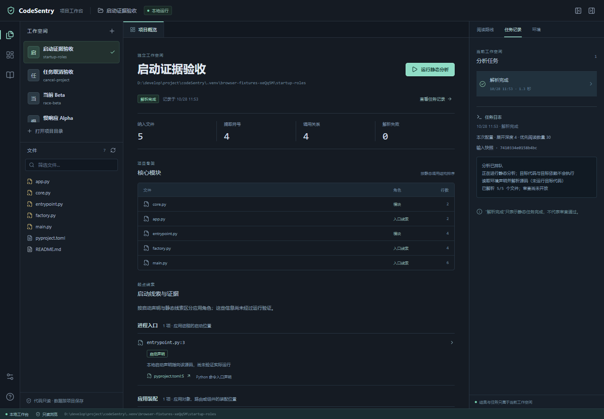

# P1 导航证据与阅读路线开发复测

> 2026-10-27 · 本轮为 P1.5/P1.6 的实现与开发诊断；P1 整体仍未通过。
> 当前结果索引：[结构化记录 v2](../../evals/reports/navigation_development_20261027_v2.json)，保留前一份记录及其摘要。本轮不执行目标项目代码、不安装目标依赖、不收集目标测试，也没有模型调用。
> 后续更新：[性能优化与标注准备](P1_性能优化与标注准备.md)。本文41s/33s及其“L1/L2”表述应理解为构建加渲染，未包括前置准备与实际写出；后续入口已严格分开完整输出、后验审计就绪与命令总时延，保留所有较慢观测。最新回归与已确认整体接手任务见后续记录，本文其余计数保留历史。

## 用户可见的变化

工作台将进程入口、界面挂载、桥接上下文、应用装配、待确认候选分开显示，同时显示启动声明、静态证据或名称线索。点击证据可打开对应文件；无法确定行号时不虚构第 1 行。启动配置变化与源码变化分别提示，未确认的入口不计为已运行验证或人工金标。

文件名 `App`、`main`，Python main 守卫、FastAPI 工厂或 APIRouter 注册，均不能单独证明应用进程入口。加载命令、构建映射和静态调用只有在支持的语义、绑定与权限范围内才提供相应证据；继承的容器 ENTRYPOINT 未知等情况继续保留未知。当前只解析声明，不执行声明中的命令。

阅读层级采用距有证据 process/mount 的最短静态依赖距离。展示前置、契约文件或分支配额不会改变距离；`·` 表示在展开深度内未从这些根到达。零调用出度不否定有证据的根；名称候选不因出度高而升格。优先阅读数量只控制前段推荐，完整合格文件清单仍保留。

截图使用工具自身的合成项目，不是外部项目源码。

## 输入、权限与标签边界

Research Agent 沿用工作台已有确认范围；Knowledge Loop 按用户本轮答复确认默认范围：遵守允许读取的 .gitignore，排除常见凭据，允许内容仅本地分析，模型候选范围为空。未改动其他工作空间权限。

本轮另建权限绑定的开发输入清单，存于本机 `.venv/navigation-development/nav-preflight-20261027-v1.*.manifest.json`，含源/配置/文档摘要、工作空间身份、策略版本及摘要，并在对照前后验证。清单先于真实项目评分冻结；每份有独立 SHA256 伴随文件。没有为兼容旧范围读取已禁读文件，也没有把外部源码或其文件级衍生内容送给模型；对话中只使用聚合计数。

| 项目 | 本轮允许源码 / 排序范围 | 成功解析 / 失败 | 与 v1 的差异 |
|---|---|---|---|
| Research Agent | 155 / 84 | 155 / 0 | 4 项旧输入发生访问范围冲突；3 项启动输入未在 v1 冻结 |
| Knowledge Loop | 140 / 77 | 140 / 0 | 1 项旧源码范围冲突；1 项启动输入未在 v1 冻结 |

允许文件均解析成功不代表整个仓库审查完整：权限受限与声明未知仍保留，两个结果的 `is_complete` 都为 false。禁止把“解析失败 0”解释为完整性通过。

原 `navigation_v1.json` 和原 GT 未改。原标签仍缺 Research Agent 的具体前端关键文件，且有 3 项未匹配；入口人工金标仍未裁决。未标注推荐保持未知，不当作真实负例；未匹配标签不从分母删除。当前清单与 v1 范围不同，以下对照不能替换此前历史基线，也不是正式验收或 holdout 结果。

## 结构机制检查与真实项目反例

固定的 22 个合成结构案例检查真实距离、循环/重复、完整清单、零出度根、弱候选、深度与参数边界。旧阅读器通过 5/22；首次距离修正及最终阅读器均通过 22/22。它只证明结构性质，不证明 P@10。

首次真实项目对照暴露退化：只从证据较强的前端根展开，使缺少启动声明的后端分支延后。两项目的旧文档标签命中分别由同图旧算法的 5/10、6/10 变成 0/10、5/10。初版记录保留在 `navigation_ablation_*_20261027.json`，没有改标签、隐藏前端或只保留有利结果。

修复采用通用分支机制：从真根有向不可达的静态/声明装配或桥接节点，按可达关系选择上游分量代表作展示支点，按轮次展开各分支。共享契约不会把后端误判为已被前端覆盖；支点不产生 L0，也不改变真实距离。容量足够时，契约前置与层级配额为各分支首轮直接依赖保留席位；容量不足时不承诺全覆盖。深度 0 不沿支点展开。

独立补充的 9 个合成分支案例中，修复前为 3/9、修复后为 9/9；另有一项小窗口容量反例验证 5 条分支在 10 项容量内的首轮覆盖。该补充集是开发反例，不冒称封存集或独立效果金标。原 22 案例、补充 9 案例及历史失败记录均保留。

## 同图消融与性能

对照固定当前解析器、图与权限范围，仅替换检测器/阅读器。旧算法来自固定哈希的 CodeSentry 自身历史代码，不导入或执行被分析项目的任何模块；这不是历史二进制全栈回放。每种结果保留完整的标签分母 38 / 11，前 10 项不足时不计为 P@10 达标。

| 项目 | 旧检测器 + 旧阅读器 | 新检测器 + 旧阅读器 | 分支修复后的新检测器 + 新阅读器 |
|---|---|---|---|
| Research Agent | 5/10 | 5/10 | 6/10 |
| Knowledge Loop | 6/10 | 6/10 | 6/10 |

这些是当前范围下沿用旧文档正例的描述计数，仍低于既定 8/10 目标；不能由小幅变化推出实际接手效果改善。位置校验还检查启动配置证据的冻结身份、权限、摘要和显式行号；位置正确不推出入口语义正确。

性能采用禁用解析缓存、顺序运行并包含实际 L1/L2 渲染的测量；这不代表操作系统磁盘缓存为冷。初次顺序测量 L1 为 46.91s / 33.19s，未达到 30s；并发回归期间的测量另作历史诊断，不拿缓存/并发或仅渲染时间冒充端到端性能。保留全部权限检查，针对剖析发现的 Python 作用域重复扫描建立声明表，新增 8 个绑定反例先在旧实现通过，再核对优化后语义。

最终同图对照仍为 6/10、6/10；L1 为 **41.33s / 33.22s**，L2 为 **41.33s / 33.22s**。L2 满足当前 180s 目标，L1 仍超过 30s。Research Agent 的解析阶段 17.28s、末尾快照复核 17.62s；Knowledge Loop 为 14.11s、15.00s。末尾复核包含权限、源码/配置和环境检查，不能直接删掉来保时延。后续应独立设计并验证权限等价的优化，当前不把性能标为通过。源码版本、阶段耗时和有效输入摘要见两份 `navigation_ablation_*_final_20261027.json`。

## 本轮回归与后续缺口

本轮全量后端 **460 通过、1 跳过**，前端 **32 通过**，构建通过。随后截图复核发现 Windows 隔离 worker 忽略编码环境变量，中文日志被错误解码；仅在可信启动代码显式设置标准输出/错误为 UTF-8，保留 `-I` 及全部权限检查。该修复后工作空间/权限相关后端 **52 通过、1 跳过**，真实浏览器 **5 通过**，新增中文原文与无替换字符断言，截图已重新核验。最后下线两个旧脚本的入口，新增 **4 项通过**，验证接触项目文件系统前即返回非成功；这些分批结果分别记录，不冒称同一次全量运行。

导航性能测量早于这个日志修复及历史辅助入口下线；两份消融报告内保留当时的完整实现摘要，当前记录另列后续改动，解析器/检测器/图/阅读器未变，不重写旧测量版本。普通 Windows symlink 测试因当前身份无创建权限而跳过；junction 与硬链接反例另有实际覆盖，不能用这一次跳过声称全部链接平台都已验证。完整记录与当前实现/测试摘要见结构化记录。

下一步仍在 P1：完善含前端的导航任务标签及独立入口裁决，核对性能与受限范围的适用条件，再进行固定理解任务试验。已有单测、浏览器闭环和文档正例命中不替代这些证据，P1 不标通过。

文档清理还发现旧 `extract_groundtruth.py` 直接读文档、`verify_cache.py` 未按工作空间权限复制项目后在副本做修改实验；后者当前不是原地修改源项目，但复制仍可能读取被排除内容。两者现已停用命令入口：在解析目标路径、枚举、读取或复制之前给出替代流程并返回 2；已移出 README 推荐流程，保留历史提取/快照函数。测试使用不存在的合成项目及文件系统调用拦截，没有对真实项目运行旧流程。日后如恢复这些入口，须先实现同一访问合同与新验收。

模型使用范围的第三档设置随 P4 的实际接入提供，届时需展示具体服务/模型、用途、范围、发送预览和预算；文件成为模型候选不等于授权发送。当前界面只提供完全排除和仅本地配置，没有真实模型/embedding 调用，不预先给项目开放模型权限。

## 复算入口

`python -m evals.navigation_structure` 与 `python -m evals.navigation_coverage` 只使用本工具固定的合成图。`python -m evals.navigation_development` 按已经确认的工作空间权限建立新的本地开发清单；`python -m evals.navigation_comparison` 消费该清单，输出新名称的对照记录，拒绝覆盖已有报告，输入/权限/工具实现漂移时丢弃对照。对照脚本退出 0 仅表示记录有效，质量是否通过看 `formal_acceptance`，本轮始终为 false。执行方式和完整结果见对应模块与结构化记录，不要求为复算放宽权限。
