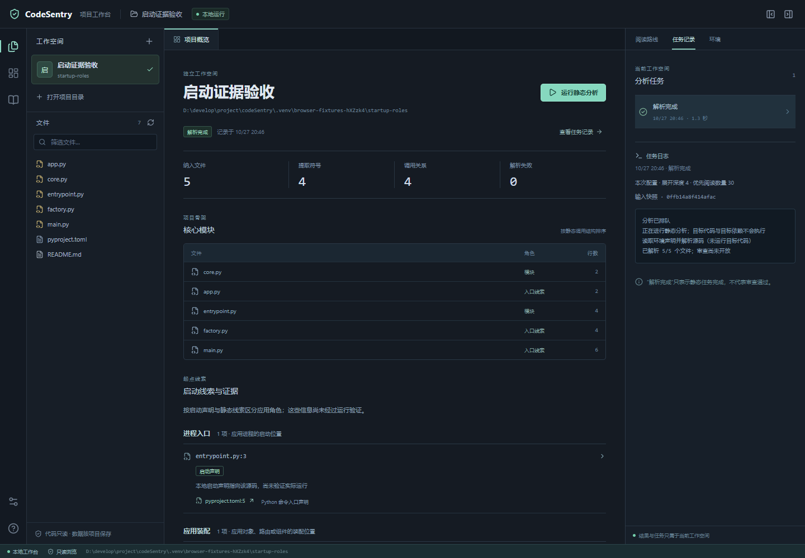

# P1 性能优化与人工标注准备

> 2026-10-27 · 当前继续 P1，不启用模型、目标代码执行或后续门禁。
> 结果索引：[本轮结构化记录](../../evals/reports/p1_progress_20261027.json)；[上一轮导航记录](P1_导航证据与阅读路线复测.md)保留历史。
> 后续（2026-10-28）：[P1开发预览已交接，进入P2A](P1_阶段交接与P2启动.md)。本文保留当次结果；人工标签、理解试验和L1稳定性仍未通过，不再无新假设反复调优。

## 本轮改动

CLI 与后台分析共用同一个只读注册表检查器。持续使用同一连接，每次读取仍实际查询当前权限，并在查询前后核对数据库文件身份；不缓存“已授权”的结论。除版本与摘要，还固定工作空间身份、规范目录、完整权限设置和确认/清理状态。数据库被替换、删除、重复记录、只改权限而未改版本、运行中新增注册、畸形数据或检查失败都会中止；失败后不会自动接回较宽授权。

连接以只读、无持续读事务的方式打开，连接的查询和关闭串行化；CLI主入口、worker及新时延测量路径结束显式关闭，部分旧eval调用仍使用回收兜底。这个锁不构成整个AccessPolicy的线程安全证明。CLI 的旧实现每次检查重复连接和检查表结构，而且 `with connection` 本身不负责关闭连接；本轮改为有明确生命周期的检查器。[Python SQLite 连接说明](https://docs.python.org/3.14/library/sqlite3.html#how-to-use-the-connection-context-manager)

路径检查用一次新的、不跟随链接的元数据读取判断符号链接和 Windows reparse point，保留每个原有检查时点、硬链接多别名拒绝、规范路径后的规则检查和读取前后复核。元数据权限错误保守拒绝，不能解释为普通文件。这个优化不代表消除了路径竞态，也不证明支持所有第三方重定向类型。[Python 文件类型与属性说明](https://docs.python.org/3.14/library/stat.html#stat.FILE_ATTRIBUTE_REPARSE_POINT)

启动配置扫描提前按配置文件名及算法范围过滤，避免为无关文件重复进行完整路径决策；目录仍先检查权限，所有已枚举项计入限额。全局 Git 控制扫描与策略摘要不缩小，匹配但禁读的配置继续记录未知。合成输入的新旧采集结果、未知标记和摘要一致，实际项目清单也在运行前后重新核验。

工作台核心模块表的旧结构角色 `entry` 改为“入口线索”，避免与下面有证据的进程入口混淆；真实启动角色与证据分组不变。下图仅含本工具合成项目，中文日志及证据跳转已复查。

## 时延口径与复测

纠正上一轮记录的口径：`navigation_comparison` 中的 `build_and_l1_seconds`、`build_and_l2_seconds` 是构建加渲染，没有包含前置准备，也没有实际写出报告。因此此前约 41s/33s 应称构建与渲染耗时，不能冒称完整端到端测量；这些构建下界本身已超 30s，所以原先“性能未通过”的结论不变。旧 JSON 与失败记录保留，不重写历史。

本轮保留同一权限绑定的输入清单、155/140 个允许源码、84/77 个排序文件和原标签。关闭解析缓存，顺序复测；操作系统文件缓存状态未受控，不称物理冷启动。

| 项目 | 此前构建+L1渲染 | 本轮构建+L1渲染 | 完整L1各次观测 | 审计后正文就绪 |
|---|---|---|---|---|
| Research Agent | 41.33s | 14.62s | 42.60s、20.70s、39.02s | 57.71s、27.14s、52.78s |
| Knowledge Loop | 33.22s | 11.05s | 17.12s、35.87s | 23.02s、49.81s |

完整测量使用独立 `navigation_latency` 入口：从读取可信实现/清单及校验权限之前计时，包含完整前置输入核验、构建、L1 实际写出和 flush；紧接写出 L2 并累计计时。L1/L2采用原m0验收脚本的输出边界，不后设调整30s/180s目标。后置输入/权限/实现审计和正文摘要另计入 `validated_outputs_ready_seconds`；CLI另外给出含元数据记录落盘、最终权限核对和close的总耗时，不能把较早写完的正文当作已完成后验审计的结果。

最后一次Research Agent是在与本地工作台相同的工具外执行环境测量，仍为39.02s；不能将超时简单归因于工具隔离开销。各次均未与本轮回归测试并发；主机其他负载和操作系统缓存未受控，不能据数据断言波动的具体系统原因。新旧两版时延harness的后者只增加阶段计时字段，分析核心及输入未变；全部超时与较快记录都保留。分阶段数据表明变化主要在准备与构建，正文交付约0.02–0.07s。**本轮不将L1稳定性标为通过**，不挑20.70s/17.12s两次较快结果冒充全部达标；所有L2观测满足180s目标，仅代表本机这些开发样本。

报告正文只留在工具被忽略的 `.venv` 本地目录，JSON 仅保留聚合计数、字节数和摘要；不在对话中输出目标代码或文件级衍生内容。这些是操作者管理的本地导出，不随工作台撤销自动删除。输入/权限漂移时返回失败，按文件身份尝试安全清理本次产物；删除失败或产物被替换时明确 `cleanup_pending` 和待处理数量，残留文件不得作为有效测量。guard保留至记录写出后的最后复核，不先关闭再发布成功。

## 入口评分与人工标签

修复了角色混算：应用入口指标只统计有静态/声明证据、非脚本的 process/mount 文件并去重。桥接、装配、名称候选的数量单列，不能混成应用入口预测。现有 file-only 人工标签如将来有效，只能评应用集合，不能由它推造分角色精确率；没有独立标签时依旧 N/A。

两个项目沿用旧文档正例的前 10 项命中仍均为 6/10，Recall@10 分母仍为 38/11，未删未匹配项、未把前端隐藏、未把未标注推荐判作真实负例；仍低于既定 8/10。原 v1 合同与原 GT 不变，因权限范围不同不能直接冒充旧 v1 的正式验收。

已导出两份仅限本地的人工标注草稿及中文说明：Research Agent 155 项、Knowledge Loop 140 项，覆盖完整允许源码清单，包含不参与排序的文件。关键文件与入口答案全部为 null，不展示当前排序、不预填旧文档正例。任务、部署范围、审阅身份和证据留给人核对，草稿永不自动批准。

- Research Agent：`.venv/navigation-annotations/p1-research-review-20261027-v2.json` 及同名 `.instructions.md`。
- Knowledge Loop：`.venv/navigation-annotations/p1-knowledge-review-20261027-v2.json` 及同名 `.instructions.md`。

用户已确认首轮“整体接手”任务，v2只预填任务范围和关键文件判断原则；具体主要流程、部署方式、审阅身份与所有文件标签继续待核对，v1保留。操作步骤见[人工核对指南](P1_人工核对指南.md)。任务范围确认不等于金标准确性批准。

生成草稿只核验冻结清单摘要和当前权限，**没有重新读取或 stat 清单里的源码**，故明确 `source_snapshot_revalidated=false`。正式评分必须再完整核验源码/配置与当前权限，不能将草稿改个 status 就视为已裁决。草稿是操作者管理的本地导出，权限撤销不自动删除该副本；它及其文件名、摘要、标签和证据均不能自动发送给模型。

## 验证与剩余工作

权限检查器、路径元数据、启动扫描、入口计分及草稿设施分别有合成反例：实际提交后的权限变化、数据库替换/删除、未注册后新增、类型伪装、跨线程与关闭、嵌套忽略规则、禁读控制、枚举上限、真实 hardlink/junction、低置信候选混算、无标签 N/A、拒写源码、拒覆盖和中途撤销清理。Windows拒绝操作活SQLite句柄时，替换测试先释放raw句柄再验证pinned identity先于查询拒绝，不冒称验证了POSIX活句柄替换。最终全量及浏览器结果见结构化记录，不合并重复执行的计数。

| 检查 | 本轮结果 |
|---|---|
| 最终Python全量回归 | 553通过、2跳过；`.venv/p1-progress-release.xml` |
| 前端现有测试与构建 | 32通过，构建通过；最终bundle为 `index-Dbxk6N94.js` |
| 真实浏览器 | 5流程通过；文案修正后启动证据流程另复核1项，通过 |
| 跳过项 | 2项普通symlink创建受当前Windows身份限制；hardlink/junction反例实际执行 |
| 曾发现的回归 | 全量曾1失败/551通过/2跳过：未确认范围的初始拒绝从输入不可用2误归类为运行期冲突1。已保留原非成功语义并恢复退出约定，补测旧schema与真实未确认workspace，修复后全量通过。 |

最后的退出状态修复只涉及CLI初始拒绝分支；时延测量均为已确认合法范围，分析器、扫描器和热路径未再改。报告保留测量时实现摘要，并另列这次后续修复和前端文案变动，不回写历史时延记录。

P1 仍待完成：包括前端的任务化关键文件标签、独立入口裁决和固定理解任务试验。速度、解析成功和位置错误 0 都不能替代这些质量证据；不改变 P@10≥80%、入口召回100%/精确率≥0.9 的目标，也不以模型输出冒充人完成标注。
