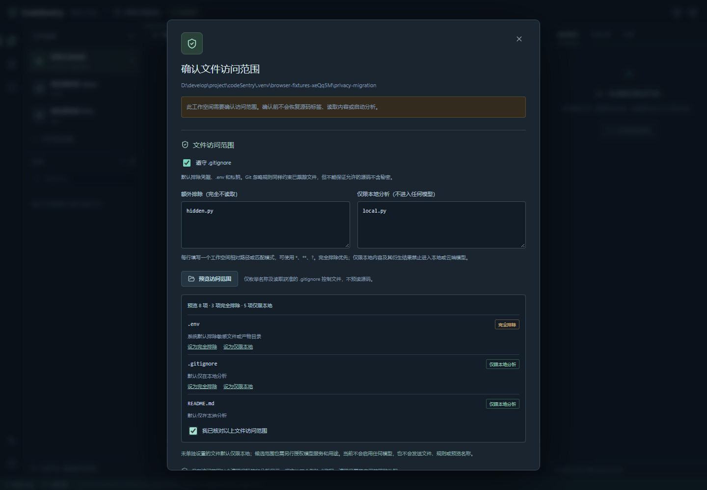

# P1.10–P1.11 文件访问权限实施与验收

> 日期：2026-10-27 · 用户确认同时提供“完全排除”和“仅限本地分析”。
> 合同：[工作空间方案§3.1](../CodeSentry_工作空间与本地前端方案_v0.1.md#31-文件访问范围)

本轮将已确认方案接入实际工作台。新增权限的回归记录独立于原工作台278/19/3项历史证据；本轮不修改导航金标、冻结评分合同或降低P@10目标，P1整体仍未通过导航质量验收。

## 实际行为

| 权限 | 实现范围 |
|---|---|
| 完全排除 | 文件内容阅读、解析、环境识别、内容哈希、敏感内容检测及模型准备均先拒绝；本地配置预览可列出必要名称及原因 |
| 仅限本地分析 | 工作台可读、静态解析可用；来源权限随结果保留，禁止进入模型准备入口 |
| 模型可用候选 | 仅表示路径资格；默认没有此范围，必须另有具体服务/用途授权。当前不启用任何真实模型 |

`codesentry/access`统一处理默认敏感路径、用户规则、根/嵌套`.gitignore`及路径检查。模型、Git例外和算法`policy.yaml`不能解除用户排除。规则同样约束已跟踪路径；首版不自动读取全局Git配置或`.git/info/exclude`。

Windows权限匹配处理大小写等价，读取前规范已有路径；符号链接/junction及具有多个硬链接别名的文件保守拒读。禁读、损坏或无法安全解析的忽略控制文件不会为求值而绕过权限，受影响范围保持拒绝。

文件浏览、环境配置读取、源码发现/解析、快照复查、缓存、索引、后台worker及CLI均接入访问策略。实际读取前后检查当前权限；后台worker与已注册工作空间的CLI会复核可信注册表版本，旧快照不能继续授权读取。元数据轮询按工作空间复用规则状态，控制文件内容摘要与目录变化仍会触发重新计算，不能只依据mtime假定忽略规则未变。

默认缓存和索引位于各自应用数据目录的`scopes/<access_fingerprint>/`下；不同权限并发写入时，物理产物互不覆盖。单独的权限标记文件不足以解决宽/窄范围的交错写，已用实际交错写反例校验。源码目录内的缓存禁用，测试与正常使用应把源码和应用缓存分开。显式导出到项目的索引使用`index.<access_fingerprint>.json`，其保留产物名称及标记、临时索引不能被普通源码API或模型原文入口重新读入。旧用户`index.json`视作导出副本，不读取、不自动删除；受管清理只处理已验证scope目录中的已知应用文件，不递归删除未知用户文件。

## 页面与旧工作空间

新建目录表单及工作空间设置提供两组路径/模式、默认开启的Git忽略选项、生效预览及确认操作。预览只枚举目录项和读取获准的Git控制文件，不预读源码；输入改变后旧预览失效。

旧数据库升级增加权限元数据，不自动确认旧工作空间。确认前不恢复源码标签、不请求源码/分析历史内容、不启动新分析。升级迁移也先取得数据目录实例锁，避免另一个服务仍运行时先修改其数据库结构。

预览返回当前工作空间版本，提交确认时校验`expected_version`；旧预览、同目录重开和两个窗口同时创建的冲突返回409，必须重新预览确认。源/Git规则指纹不能替代这一版本检查。

收紧权限时先关闭受影响的服务端入口，再停止旧worker并处理受管产物；旧任务结果不能在取消后发布。无法逐项证明来源时，保守使该空间全部旧分析及日志失效、清理受管结果并重新分析；本版对其他权限变化也采用此策略。源代码本身不被删除或改写。

同页保存范围时先清除旧预览、标签及阅读器状态；其他页面通过约2秒一次的元数据轮询核对版本后清除，后台页面可能受浏览器调度影响。服务端不等待页面轮询才拒绝读取。迟到的源码及结果响应须匹配当前版本和摘要才能进入界面。清理失败显示待清理并保持访问关闭，允许重新保存范围重试。

## 命令行

已有工作空间使用其已确认策略；状态目录与网页保持一致，例如：

```powershell
.venv/Scripts/codesentry.exe onboard D:/projects/example --workspace-data-dir .venv/workbench-data
```

未注册项目须显式确认本次本地分析范围：

```powershell
.venv/Scripts/codesentry.exe onboard D:/projects/example --confirm-access --exclude "private/" --local-only "internal/" --no-cache
```

`doctor`、`index`、`status`使用相同选项。也可通过`--access-policy`提供项目目录之外的可信JSON，内容为四项访问设置，或`{"root":"目标目录","settings":{...}}`。不能用更宽的临时策略解除已有工作空间的限制，也不能用`--confirm-access`绕过待迁移/待清理工作空间。可信策略文件变化或运行中撤销权限会停止读取及结果输出。

隐私规则导致实际源码/配置未参与时，报告范围受限，`is_complete=false`，CLI可返回1；这不代表发生了解析失败。不能用缩小范围后的分数代替原冻结范围的导航验收。

## 模型边界与局限

当前只有本地的模型输入准备函数及模拟调用检查，没有真实云端、本地模型或embedding调用。它默认拒绝未授权请求，重新读取当前模型候选文件，对疑似秘密先阻止；仅限本地路径无法进入该入口。外部传入的摘要、图和历史字典即使自报允许来源也一律拒绝；尚未提供可信衍生内容构造器，不把自报来源当凭据。

这些测试证明当前准备入口的约束，不代表任何供应商API、服务留存或真实模型出口已验收。P4接入时必须复验。敏感内容检查不能保证识别全部秘密；清理不承诺介质级安全擦除，已导出或已发送数据无法撤回。本轮不执行目标代码、安装目标依赖或收集目标测试。

## 验证记录

完整Python回归 **359通过、1跳过，56.05秒**；前端 **26项通过**；TypeScript检查及生产构建通过；真实Chrome浏览器 **4项通过，23.5秒**。原始计数、实现摘要与固定范围见[结构化验收记录](../../evals/reports/access_permissions_20261027.json)，不沿用旧工作台测试数。Python依赖一致性、文档链接及格式检查通过。

唯一跳过为Windows账户不能创建普通符号链接；实际junction和硬链接用例通过。存在一条Starlette测试客户端对httpx的弃用提示。1000文件与并发元数据轮询的真实worker取消，在最终全量中测得0.0653秒，进程已回收；此值是本机反例记录，不承诺所有机器的时延。

收尾回归调整了两处测试配置：空源码文件的缓存测试改为源码/应用缓存兄弟目录，保留二次构建真实命中断言；确认窗口测试等待409响应及界面更新完成后，再断言预览清除和提交禁用，没有放宽权限断言。

本轮浏览器流程覆盖创建/重开、权限预览、旧空间确认前零源码请求、排除文件不可读、仅限本地文件可读、远端收紧后旧阅读器清除、旧历史失效、跨项目慢响应，以及大目录任务取消。

升级后的实际工作台已在`http://127.0.0.1:8765`启动；原CodeSentry工作空间仍保持未确认，真实浏览器验证只显示范围确认窗口，没有自动源码/分析历史内容请求或页面异常。用户在工作台确认后才恢复允许的阅读与分析。



本轮发现并修复的关键反例包括：同目录POST忽略新限制、旧宽范围预览覆盖新拒绝、Windows大小写/路径别名、硬链接别名、项目内索引侧文件禁读、旧worker/CLI快照继续读取，以及大目录取消被全树复核阻塞。缓存权限与产物的并发一致性另在最终结构化记录中列明。
