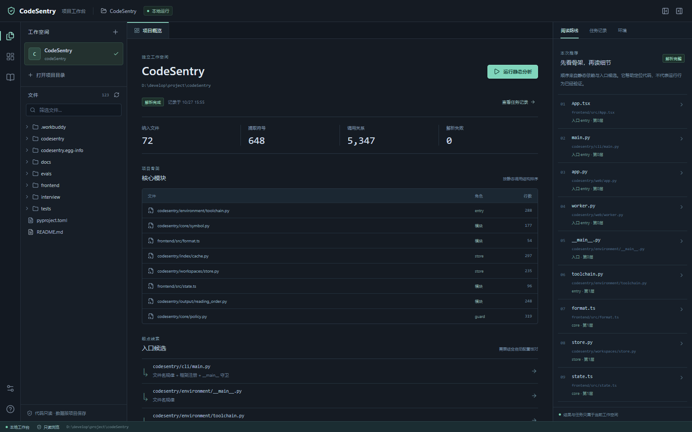
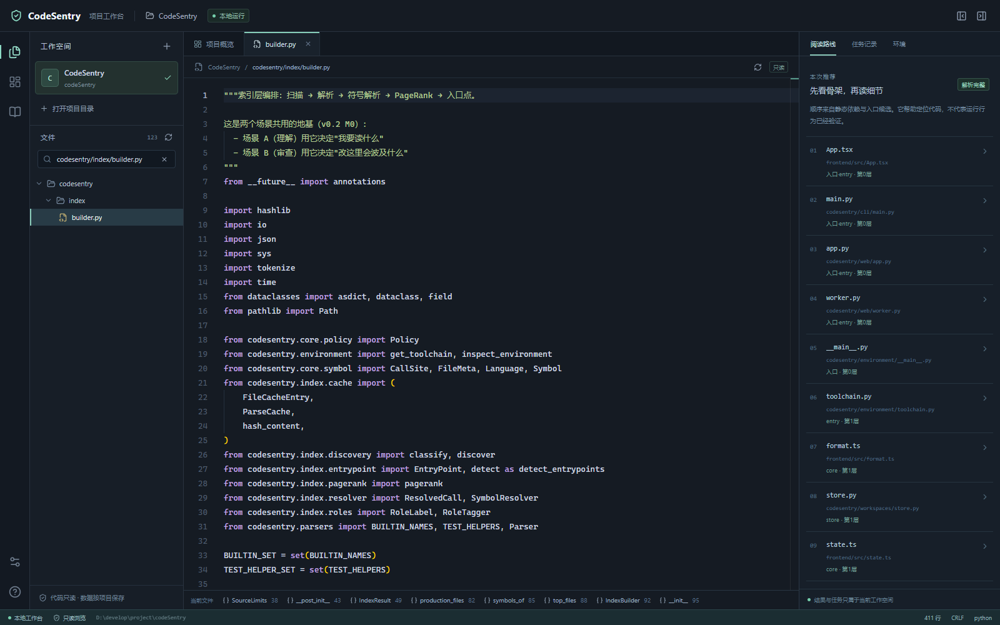

# P1 本地网页工作台实施与验收

> 日期：2026-10-27 · 范围：P1.7–P1.9
> 产品决定：用户明确选择本地网页；每个代码目录有独立工作空间。

本轮交付可从源码构建运行的浏览器工作台，复用现有静态分析核心。工作台功能验收与导航质量验收分别记录；P1整体仍未通过，原阅读顺序P@10 50%/60%未达到80%，入口人工金标与真实理解试验仍待完成。

## 已实现

| 部分 | 行为 |
|---|---|
| 工作空间 | SQLite注册表、同目录复用、不同目录独立、独立名称和分析设置；状态存放于单独data_dir |
| 文件阅读 | 文件树筛选、只读Monaco、文件标签及展开状态恢复；模型URI包含workspace_id；代码和worker均本地加载 |
| 静态分析 | 固定可信子进程，有界串行队列、状态轮询、日志、取消、历史和独立结果；不执行目标代码 |
| 结果 | 项目概览、入口候选、核心模块、阅读路线、符号行号与环境；分析完整性、失败和部分结果明确显示 |
| 历史有效性 | 文件读取与解析快照使用相同解码文本SHA1口径；源码变化提示过期；设置变化提示旧结果使用旧设置；历史配置不被改写 |
| 生命周期 | 服务重启保留工作空间与已完成历史，未完成任务标为中断；数据目录OS单实例锁在恢复任务前取得 |
| 本地边界 | loopback监听、Host/Origin/会话令牌检查、路径与凭据过滤、链接/junction拒绝、读取及输出上限 |

默认浏览器地址为`http://127.0.0.1:8765`。实际启动命令在仓库根目录执行：

```powershell
.venv/Scripts/codesentry.exe serve --data-dir .venv/workbench-data --open-browser
```

安装与构建方式见[README](../../README.md#快速开始)。当前是源码构建交付，没有独立安装包；默认网页资源为仓库内`frontend/dist`。

## 验证证据

后端和核心全量回归为 **278通过、1跳过，32.28秒**。跳过原因为当前Windows账户无普通符号链接创建权限；真实Windows junction越界案例已通过。存在一条Starlette测试客户端对httpx的弃用提示，不影响本次运行。Python依赖一致性检查通过。

前端类型检查和生产构建通过；界面与状态测试 **19项通过**，真实Chrome浏览器流程 **3项通过（13.4秒）**，详见[结构化记录](../../evals/reports/workbench_20261027.json)。使用系统Chrome，1440×1000及1000×800视口；浏览器请求未出现外部CDN，未发现页面未捕获异常。

| 反例/流程 | 已观察到的结果 |
|---|---|
| 两目录均含main.py，内容不同 | 源码、配置、任务、结果和历史分别关联所属工作空间 |
| 浏览器刷新、关闭重开服务 | 标签页/选择恢复，注册表与已完成任务保留；中断任务不冒充成功 |
| A文件响应故意延迟后切B | 旧响应未覆盖B文件、面包屑或标签 |
| 初始化尚未完成即发起分析 | 提交入口暂禁用，防止旧列表覆盖新任务；取消后历史仍保留 |
| 真实静态分析与取消 | 成功任务返回真实结构化结果；取消显示已取消，队列仍可处理下一任务 |
| 取消包含子孙进程的任务 | 实际子进程与孙进程退出，后续分析成功；关闭状态不被并发监控改成失败 |
| 数据目录已由服务使用 | 第二实例被拒绝且不修改第一个活任务；持锁进程真实退出后可立即重开 |
| 历史结果删除、损坏、身份不符 | 持久标为invalidated，明确说明需重新分析，不继续显示解析成功 |
| 源码修改与解码差异 | 旧分析显示源码变化；CRLF、BOM、Python编码声明按同一文本摘要比较 |
| 穿越/绝对路径/.env/junction/错误workspace | 请求拒绝；任务不可通过另一工作空间访问 |
| 错误Host/Origin/会话token | 拒绝本地文件与管理能力请求 |
| 修改本次分析之后的工作空间设置 | 旧结果仍保留原配置，同时显示设置已变化；新设置只作用于之后任务 |

Windows持锁退出测试最初误终止了虚拟环境启动器，而非真实解释器；已改为等待实际持锁进程句柄确认退出，无退避/重试，连续五次通过。产品锁未因该测试放宽。

## 实际界面

以CodeSentry自身目录注册工作空间，在最终版本停止修改后运行静态分析，结果为72个源码文件、648个符号、0个解析失败、完整解析。首轮分析与前端测试文件写入重叠时，正确记录source_changed和部分完成；随后重跑完整成功，旧任务仍留存。此例仅验证产品联通及状态行为，不增加独立导航质量得分。





## 仍待完成

- P1导航质量、入口人工金标与真实理解试验；不因UI可用降低原门槛或重写旧GT。
- P2目标代码隔离执行与运行验证；当前工作空间和可信解析进程不构成OS沙箱或多租户隔离。
- P3/P4审查门禁、模型语义和聊天；当前不展示虚构审查通过或AI回复。
- 独立安装包、跨平台完整验证与UI性能硬指标。当前验收环境为Windows，Monaco懒加载压缩包约696KB，尚未设定页面交互时延硬阈值。

默认上限：源文本读取2MiB，分析结果32MiB，队列128项，串行worker，单任务180秒。它们是资源边界，不表示已经通过并发压力或不互信多用户验证。
