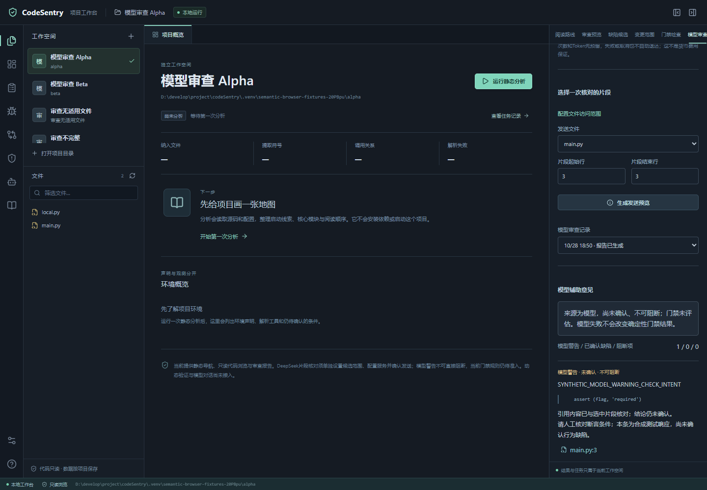

# P4 首轮：DeepSeek 接入与 P3 开发交接

记录日期：2026-10-28。用户同意 P3 完成度合适时进入 P4，并指定首个服务为 DeepSeek。本轮交付范围是可逐次确认的片段审查；完整语义审查质量尚未验收。

## 阶段决定

P3 可以按开发预览交接。导航、80行策略债务、失效断言候选、变更范围、门禁检查均有独立任务和结果；批准基线、四态门禁及固定策略合同已有实现。80行规则继续只提示。保留的 P3 工作包括：独立人工缺陷标签与效果评估、生产规则准入、正式门禁豁免、可信 CI 部署和完整影响范围。生产必检规则尚未准入，门禁仍为 `incomplete/3`，没有因进入 P4 而记为正式通过。P1/P2 原有质量待办和历史证据保持有效。

## 已实现的首轮范围

| 项目 | 本轮行为 | 检查条件 |
|---|---|---|
| 独立入口 | 工作台新增“模型审查”，与前五类结果分开 | 保存模型设置只失效模型结果，不抹掉其他静态结果 |
| 工作空间设置 | 固定 DeepSeek 官方地址；可选 `deepseek-flash` / `deepseek-v4-pro` | 默认关闭；设置以版本比较更新，其他窗口的旧设置不能覆盖新设置 |
| 密钥 | 在本地页面输入；按工作空间存放于服务进程内存 | 不进项目、数据库、日志、任务参数、命令行或浏览器持久存储；服务重启后须重新输入；可主动清除 |
| 文件范围 | 原有第三档 `model_scope` 在页面开放编辑，默认仍为空 | “模型候选”只给候选资格；用户排除、本地专用和常见凭据拒绝优先 |
| 精确预览 | 用户选一个文件及连续行段，显示完整消息、请求 JSON、模型、用途和限制 | 每次发送另行确认；系统提示也可见；不附加其他文件、图、旧报告或任意衍生上下文 |
| 单次发送 | 预览有效期 300 秒；确认绑定工作空间、权限版本、设置版本和完整原文件摘要 | 内容、权限或设置变化即失效；确认尝试消费凭据，不自动重放或重试 |
| 供应商通道 | 固定 HTTPS 地址、证书校验、不跟随重定向、不使用环境代理、不自动重试 | 测试可在可信 Python 启动器内注入本机传输；生产 CLI/API 没有任意地址配置 |
| 响应处理 | 严格解析警告 schema，逐字检查引文，核对行号和源快照 | 原始响应、思考过程和提示正文不落盘；空响应、截断、无用量、错误字段等明确报告未完成 |
| 结论边界 | 所有模型内容标为 `llm`、未验证、不可阻断 | 引文匹配只说明引用存在；不等于缺陷成立，也不授予 Finding 凭据或基线批准资格 |
| 撤销与清理 | 取消、关闭设置、清密钥、权限变更可停止在途请求 | 不发布迟到响应；权限改变清理全部受管历史，模型设置改变只清模型历史；清理失败关闭相关访问 |

API 遵守本地会话和来源检查。含密钥请求的字段验证错误只返回固定提示，避免框架默认的输入回显。代码注释等目标文本作为数据处理，模型没有工具、执行代码或扩大范围的能力。

## 服务行为与预算

按当前官方文档采用 `https://api.deepseek.com/chat/completions`、非流式、关闭思考和 JSON 输出模式；文档仍提示 JSON 模式可能产生空内容，因此按不完整处理。[Chat Completion](https://api-docs.deepseek.com/api/create-chat-completion/)、[JSON 模式](https://api-docs.deepseek.com/guides/json_mode/)

DeepSeek 官方说明上下文缓存默认开启并存于磁盘，未使用缓存通常在数小时至数天内清理。这不是所有 API 数据和日志的留存承诺。本轮未取得可证明“零留存”或“禁止训练”的供应商承诺；页面在确认前展示缓存说明及官方链接，用户可选择不发送。[上下文缓存说明](https://api-docs.deepseek.com/guides/kv_cache/)

首轮硬限制：单片段最多 120 行、UTF-8 正文最多 8 KiB；本地读取单文件最多 2 MiB；输出上限 1024 token；每次最长 30 秒、无自动重试；响应体最多 256 KiB。每个工作空间在本次服务内最多预留 3 次请求、总 token 预算 32768。预留采用保守的请求字节预算与余量，实际用量另记；取消或失败不返还预留，防止反复失败绕过上限。修改开关不重置本次已用预算；重启服务会清空会话预算，不能充当跨重启账单限额。

这是请求数和用量约束，**不是金额硬上限**；供应商用量与计费仍以其账户为准。价格、上下文计数差异和账户级费用限制需后续专门完善。[官方价格表](https://api-docs.deepseek.com/quick_start/pricing/)

## 使用顺序

1. 在该工作空间的文件访问设置里，将本次允许的文件加入“模型候选”；保留不读和本地专用限制。
2. 打开“模型审查”，选择 DeepSeek 模型，输入该工作空间的密钥并保存设置。
3. 选择文件和起止行，生成发送预览，核对完整请求及缓存提示。
4. 明确同意本次用途与片段后发送一次；查看带原文引证的未验证警告，需要时打开当前源码核对。
5. 取消任务、关闭开关或清除密钥可停止后续发送；已经到达供应商的数据不能撤回。

没有密钥或未授权模型范围时，原有本地能力继续可用。不要在聊天、仓库文件或命令行提供真实密钥。Research Agent / Knowledge Loop 的原权限不扩大，不把历史本地分析授权当成云端授权。

## 验收与下一步

本轮只对工具自有合成代码进行测试，真实 HTTP 验证使用本机模拟服务。浏览器测试启动器直接注入合成传输，不提供生产可配置外发地址。未调用真实 DeepSeek，未发送用户项目源码，也没有测得真实质量、网络时延或账单。

最终后端 **1437 通过、2 跳过**（415.16秒），前端 **94 通过并构建成功**，同一构建下浏览器 **12 条流程全部通过**（104.24秒）。两项普通符号链接用例受当前Windows身份权限限制而跳过，实际hardlink/junction反例仍有覆盖。初次完整后端1436通过/2跳过为取消窗口修复前的快照，不能当最终版本；初次浏览器11通过/1失败系合成启动器的诊断路由顺序，修复后全部重跑，原始记录保留。

交叉审查发现并修复两项实际边界：报告暂存后取消仍可能发布成功，现最终发布与取消采用同一锁并重查源快照，保留同一反例红→绿记录；模型入口收到403时可能暂留旧报告，现立即清除旧内容、提升响应代次后才等待刷新。生产发送层覆盖41项HTTP边界及1项完整App→本机HTTP→报告发布链路，全部纳入最终完整回归。位置、引用、权限和故障测试证明实现边界，不计作模型审查的 precision/recall。

新版工作台已在确认空闲后更新，两个原项目访问范围保留、模型范围全部为空、默认禁用且没有密钥，也没有创建真实项目模型任务。最新前端内容、官方固定地址、默认预算及未准入门禁均已检查。

结构化证据见[本轮报告](../../evals/reports/p4_deepseek_20261028.json)。旧P3报告、冻结语法合同及原始证据只校验、不回写。新界面截图来自工具合成代码和测试响应：

后续 P4 依次完成：用户在本地设置后进行首个真实服务试用；预登记小规模独立任务与标签；统计候选覆盖、预算截断、模型接受、位置回验和最终正确数；再评估可信派生上下文、候选驱动和金额/时延预算。正式门禁始终按 P3 独立准入，模型调用失败不会成为门禁通过依据。
