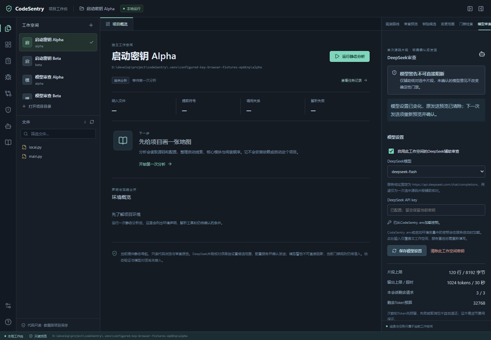

# P4：通过 .env 或环境变量长期配置密钥

日期：2026-10-28。用户要求一次填写并长期复用 DeepSeek API key；此前只支持工作空间内的临时内存密钥。本次增加可信的启动配置，模型文件范围、逐次发送确认和不可阻断的警告边界继续执行。

## 本地设置

本仓库的配置文件是 `D:/develop/project/codeSentry/.env`，已创建空模板。只在本地将等号后的空值换成自己的密钥：

```dotenv
DEEPSEEK_API_KEY=你的DeepSeek密钥
```

保存后重启 CodeSentry 服务。网页显示“已从CodeSentry .env加载密钥”时，无需再在密码框重复输入。此后每次启动都会读取同一配置文件。只刷新浏览器不会重新读取文件。

默认文件固定为 CodeSentry 安装目录的 `.env`，与当前工作目录、选中的项目、`--data-dir` 无关。也可显式指定自己管理的可信配置文件：

```powershell
.venv/Scripts/codesentry.exe serve --data-dir .venv/workbench-data --env-file "D:/private/codesentry.env"
```

或在启动 CodeSentry 的系统环境中设置 `DEEPSEEK_API_KEY`。进程环境变量优先于文件，显式空环境变量也会阻止文件回退；非法值会拒绝启动，不会悄悄使用另一把密钥。文件支持 UTF-8/BOM、普通赋值、单/双引号、注释和可选的 `export` 前缀；不执行命令、不插值或转义密钥、不读取其他变量、不修改进程环境。缺少默认文件时继续提供本地能力；显式指定的文件无效则提示错误。

## 工作空间行为

启动配置可供各工作空间共用，但不会自动启用模型、增加 `model_scope` 或发送任何内容。每个工作空间仍需选择候选文件、保存自己的开关、预览并确认当次请求。

页面输入的密钥是当前工作空间的临时覆盖，优先于启动配置；重启后覆盖消失。“清除此工作空间密钥”同时移除临时覆盖并持久记住本空间不使用启动密钥，其他空间不受影响，重启也不会自动回退。点击“使用启动配置密钥”才恢复；该操作不会自动启用模型或扩大文件权限。

修改密钥来源继续使用设置版本校验，旧预览、在途模型任务和模型历史会失效；原有确定性结果独立保留。密钥值不进入 API 返回、数据库、分析任务参数、日志或浏览器持久存储；数据库仅保存是否允许使用启动配置等非秘密状态。已知启动密钥即使被覆盖或停用，仍会参与发送正文、文件名和模型响应的精确敏感值检查。

## 文件与执行边界

`.env` 是本地明文配置，已被 Git 忽略；可提交的 [`.env.example`](../../.env.example) 保持空值。服务不会扫描或自动加载被审项目的 `.env`；同名目标文件仍遵守文件拒绝规则。显式 `--env-file` 由本地启动者指定，不提供网页远程选择配置文件的接口。

密钥不会从 `.env` 导出到 `os.environ`，分析 worker、Node 工具链和执行后端沿用环境白名单，不转发 `DEEPSEEK_API_KEY`。不把这一点扩写成所有系统启动行为的环境继承保证。符号链接、junction/重定向路径、多硬链接、超限及格式不明的配置文件保守拒绝；解析错误不回显原值。

## 本轮验证

使用合成密钥与合成代码验证读取优先级、启动快照、工作目录与目标 `.env` 混淆、清除/恢复、重启、配置迁移、不回显、已知密钥过滤及分析进程环境。浏览器服务只注入固定的合成启动密钥，真实供应商传输禁用，不读取真实配置。

最终后端相关回归 **300通过、1跳过**（122.33秒），范围含全部网页、语义服务/传输/启动配置和环境测试；没有重跑无关的全量静态算法测试。1项普通符号链接用例因Windows身份权限跳过，实际hardlink/junction已有覆盖。前端完整 **100通过并构建成功**，浏览器旧流程与新增配置流程合计 **13条全部通过**（89.12秒）。配置服务专项90和接口/启动专项51均包含在相关回归中，不重复累加。初次测试参数名称过长、前端测试类型报错记录保留；生产逻辑的已知启动密钥在被覆盖或停用时仍须过滤，已按独立反例补充并通过。

工作台已在确认空闲后重启并升级配置数据库，重启前后核对了原有权限、模型开关和任务编号，均保持一致；来源与有无状态可见，密钥值不返回。结构化记录见[本轮报告](../../evals/reports/p4_env_key_20261028.json)。以下界面来自合成配置：



本次不测模型质量、真实账单或供应商留存；没有真实 DeepSeek 请求，也未发送用户项目源码。上轮完整回归与历史记录保留，见[首轮接入记录](P4_DeepSeek接入与P3开发交接.md)；不能把上轮完整回归数字当作本次重跑结果。
